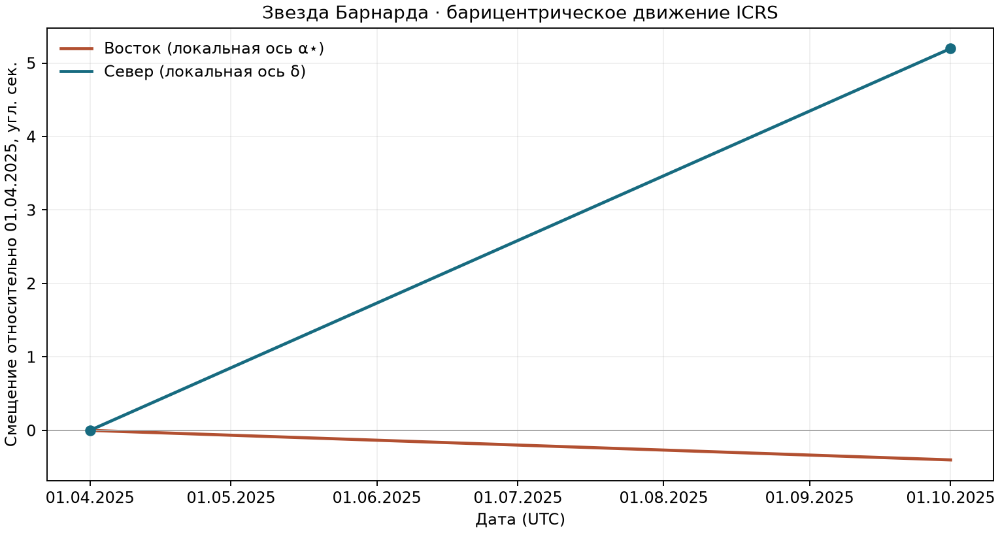

# SPHEREx Blink

Explore NASA SPHEREx observations over time: look up a target or sky position, compare images from different epochs, and inspect image quality, candidate positions, spectra and light curves.

**[Open SPHEREx Blink](https://spherex-sky-viewer-zeta.vercel.app/)** · **[Five-target GIF gallery](https://spherex-sky-viewer-zeta.vercel.app/challenge-demo/)** · **[User guide and data interpretation](docs/USER_GUIDE.md)**

> **Scientific use:** Images, predicted positions, centroid candidates and difference residuals are exploratory. They do not by themselves establish a source identification, proper motion or variability. Check the displayed quality information, masks, spectral comparability and validation status before drawing conclusions.

This project was developed for NASA Space Apps 2026 using data from NASA SPHEREx via NASA/IPAC IRSA. The hosted application may include newer changes than the code currently on GitHub.

## What you can do

- Search by object name, select a test object, or enter right ascension and declination.
- Choose a field of view and detector, then display single exposures, epoch coadds, differences or a time-coloured trail.
- Step through dates or play a sequence, with optional flags, catalogue-predicted positions and centroid candidates.
- Use an optical reference map for orientation, and request a spectrum or light curve when suitable measurements are available.
- Share a view or explore the [saved five-target gallery](https://spherex-sky-viewer-zeta.vercel.app/challenge-demo/).

Start with the [user guide](docs/USER_GUIDE.md) for step-by-step instructions, an explanation of the overlays and plots, and the limits of the results.

## Run locally

Install Git and [uv](https://docs.astral.sh/uv/), then run:

```sh
git clone https://github.com/dmitryceohris/nasa_space_apps2026.git
cd nasa_space_apps2026
uv sync --locked --python 3.12.13
bash start.sh
```

Open <http://127.0.0.1:8000/>. Installation and live archive searches require network access. Some previously saved or cached data can be used offline; availability depends on the files present locally. The local checkout can differ from the hosted application.

To run the test suite:

```sh
uv run --offline --locked pytest -q
```

### Reproduce the Barnard's Star example

The saved example propagates the catalogue position for three selected SPHEREx observations. This is a prediction, not a measurement of motion from the images.

```sh
uv run --offline --locked python barnard_motion.py \
  --observations data/irsa_barnard_20261114/observations.csv \
  --output output/barnard_positions_irsa.csv
```

For the educational notebook:

```sh
uv run --offline --locked jupyter lab output/jupyter-notebook/barnard_motion.ipynb
```



The plot uses the illustrative dates 1 April and 1 October 2025, not the three selected IRSA observations. The chosen observations span 196.354049 days; their predicted displacement is 5.594198 arcseconds.

## Python interface

The processing pipeline is also available as the `spxhack` library in `src/spxhack`. It is not packaged separately, so run it from the repository and add `src` to Python's import path. The [example notebook](examples/spxhack_demo.ipynb) demonstrates an exploratory workflow; catalogue-assisted selections are not independent motion measurements.

```python
import sys
sys.path.insert(0, "src")
import spxhack as spx

target = spx.target("barnard")
exposures = spx.fetch(target, det=3, fov=3)  # Live IRSA search and cutouts
stack = spx.stack(exposures, target, fov=3)

stack.cube                  # Epoch, y, x; MJy/sr
spx.diff(stack)             # Relative residuals, not calibrated sigma
spx.trail(stack)            # Time-coloured visualisation
track = spx.track(stack)    # Candidate positions and quality
motion = spx.fit_motion(track)
spectrum = spx.spectrum(exposures, target)
lightcurve = spx.lightcurve(spectrum, 2.0, 2.2)
spx.show(stack, track=track)
spx.save(stack, "out/")
spx.to_fits(stack, "cube.fits")
```

`spx.track` normally uses unambiguous candidates and applies a distance check when a prediction is available. `assist=True` can use the catalogue prediction to select or refine a candidate; assisted points are excluded from a motion fit unless explicitly requested. Formal centroid uncertainties do not include every systematic effect. A numerical result or fitted motion is not necessarily scientifically validated. See `spx.METHODS` and the [science assessment](docs/SCIENCE_REMEDIATION.md) for the method and its limits.

## Data and scientific context

- [Parameters and references for the five targets](OBJECT_PARAMETERS.md) and the [parameter table](OBJECT_PARAMETERS.csv).
- [Five-target position predictions and methods](docs/PHYSICS.md), including predicted positions for real epochs. Predictions are not image-based motion measurements.
- [Barnard's Star calculation and method](BARNARD_MOTION.md), [selected observation list](data/irsa_barnard_20261114/observations.csv) and [calculated positions](output/barnard_positions_irsa.csv).
- [Input-data and IRSA search assessment](AIGERIM_DATA_CHECK.md). The original supplied field corresponds to the NGC 6822 region rather than Barnard's Star; the three Barnard observations were found in a separate search.
- [Science remediation and validation](docs/SCIENCE_REMEDIATION.md), [target validation](docs/TARGET_VALIDATION.md) and [gallery scientific notes](frontend/challenge-demo/STATISTICS.md). Some detailed historical documents and machine-readable source values are in Russian.
- [API reference](docs/API.md) and [deployment notes](docs/DEPLOYMENT.md).

The 15 November science assessment describes quality statuses, calibration, photometry and astrometric checks. Accepted photometry does not imply validated motion or variability. In the examined sample, no target has a confirmed light curve or proper-motion measurement; this is a statement about that sample, not the whole SPHEREx archive. Reference-star queries used for real-image registration timed out, so registration of those frames remains unverified.

The older `barnard_motion.py` calculation provides barycentric astrometric ICRS positions without annual parallax or the SPHEREx spacecraft position. `sky_motion.py` separately provides barycentric and geometric geocentric predictions including annual parallax; these are not a complete apparent-position model. See the linked methods before comparing predictions with observations.

## Credits

SPHEREx observations are provided by NASA/IPAC IRSA. Catalogue sources and assumptions for individual targets are documented in the [target parameters](OBJECT_PARAMETERS.md) and shown in the application's observation details.
